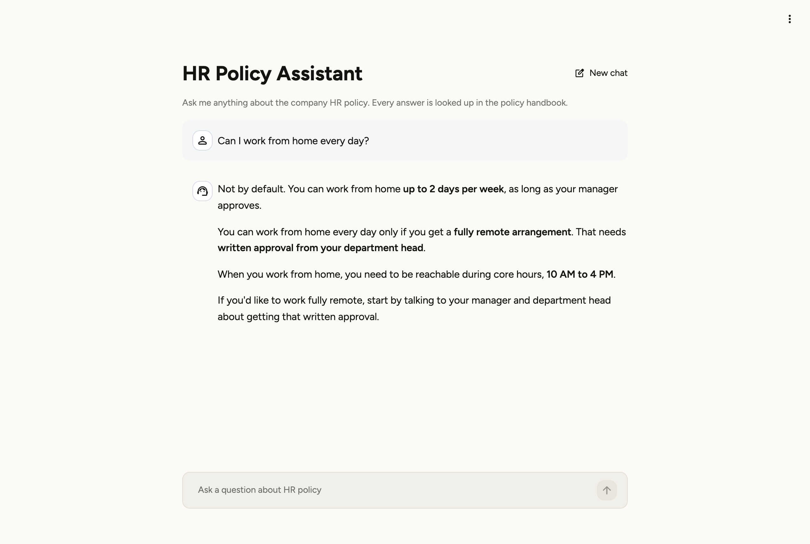
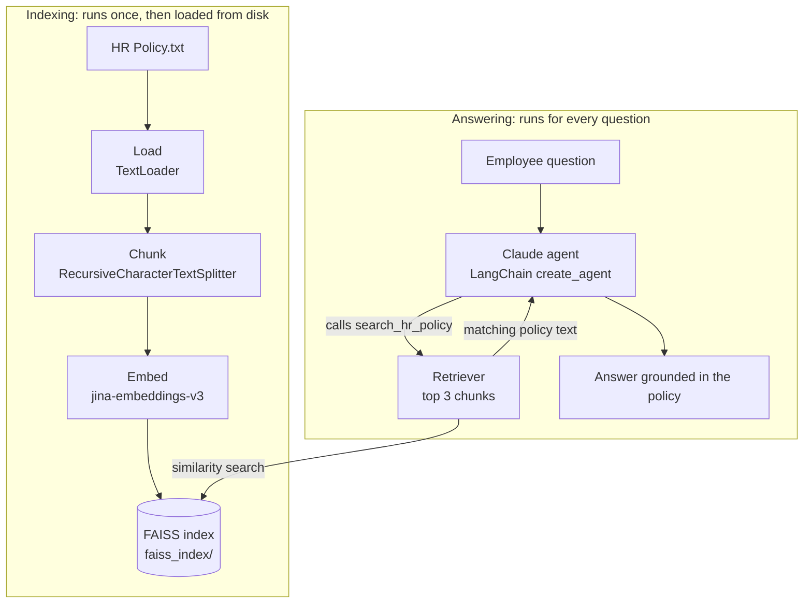
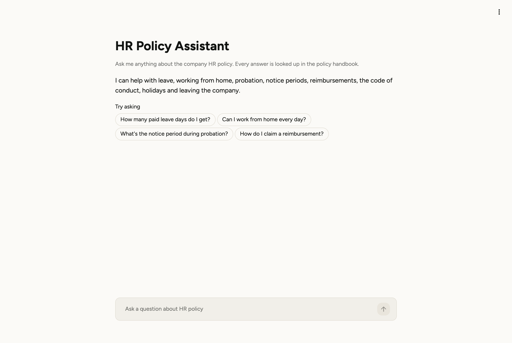

# BuildingRAG: HR Policy Assistant

A retrieval-augmented generation (RAG) assistant, built from the ground up, that answers employee questions about a company HR policy. Before answering, it looks up the relevant sections of the policy handbook, and when the handbook doesn't cover a question it says so instead of guessing.

Built with **LangChain**, **Claude**, **Jina embeddings**, **FAISS** and **Streamlit**.



## Contents

- [Highlights](#highlights)
- [How it works](#how-it-works)
- [Design decisions](#design-decisions)
- [Tech stack](#tech-stack)
- [Project structure](#project-structure)
- [Getting started](#getting-started)
- [Configuration](#configuration)
- [The Streamlit app](#the-streamlit-app)
- [Limitations and roadmap](#limitations-and-roadmap)
- [Security notes](#security-notes)

## Highlights

- **Grounded answers.** Every factual answer is written from policy text retrieved at question time. If the search results don't cover the question, the assistant says it doesn't know.
- **Agentic retrieval.** Claude decides when to search and what to search for. It can split a two-part question into two searches, and it skips retrieval for small talk.
- **Fast restarts.** The vector index is saved to disk after the first run and reloaded afterwards, so the handbook isn't re-embedded every time the app starts.
- **Modular pipeline.** Each stage (load, chunk, embed, store, retrieve, generate) lives in its own module and is shared by a command-line demo and a Streamlit web app.
- **Learning notebook.** [`RAG.ipynb`](RAG.ipynb) walks through the same pipeline cell by cell, with notes on what each step does and why.

## How it works

The system has two phases: **indexing**, which prepares the handbook for search, and **answering**, which runs for every question.



### 1. Indexing

1. **Load.** `TextLoader` reads `HR Policy.txt` into a LangChain `Document`: the text plus metadata recording its source file.
2. **Chunk.** `RecursiveCharacterTextSplitter` splits the text at paragraph breaks first, then line breaks, then spaces, into chunks of up to 500 characters with a 50-character overlap. Every section of this handbook is between 218 and 451 characters, so the result is 9 chunks: the title block plus one chunk per policy section.
3. **Embed.** Each chunk is converted into a vector with `jina-embeddings-v3`, so that text with similar meaning ends up close together.
4. **Store.** FAISS builds an exact-search index over the vectors. It is saved to `faiss_index/` and reloaded on later runs.

### 2. Answering

1. The question is sent to an agent built with LangChain's `create_agent`, using Claude Opus 5.5 as the model.
2. The system prompt tells Claude to look facts up with the `search_hr_policy` tool before answering, and to say it doesn't know when the results don't cover the question.
3. When Claude calls the tool, the question is embedded with the same Jina model and FAISS returns the 3 most similar chunks. Their text is sent back to Claude.
4. Claude writes the answer from that text. If it decides it needs more information, it can search again before answering.

## Design decisions

| Decision | Reasoning |
|---|---|
| **500-character chunks, 50-character overlap** | Matches the handbook's structure: one chunk per policy section, so every retrieved chunk is a complete topic. The overlap guards against sentences being cut in half in longer, less structured documents. |
| **Top 3 chunks per search** | Enough to cover questions that touch more than one section (for example, leave during probation) while keeping the prompt small. |
| **An agent with a search tool, not a fixed retrieve-then-answer chain** | Claude can rephrase the search, search more than once, and skip retrieval when no facts are needed. |
| **Separate embedding model and LLM** | Each can be swapped independently. Jina produces the vectors and Claude writes the answers. |
| **Index cached on disk** | Avoids repeating embedding calls and speeds up startup. |
| **`effort="medium"` and no `temperature`** | Claude Opus 5.5 controls how much it reasons through `effort` and doesn't accept sampling parameters such as `temperature`. Medium effort suits short policy answers. |
| **Server-side refusal fallback** | If Claude declines a request, the API automatically retries it on a fallback Claude model. |

## Tech stack

| Layer | Tool |
|---|---|
| Language model | Claude Opus 5.5 via `langchain-anthropic` |
| Agent framework | LangChain 1.x `create_agent` (runs on LangGraph) |
| Embeddings | Jina `jina-embeddings-v3` |
| Vector store | FAISS (`faiss-cpu`) |
| Document loading and chunking | `langchain-community`, `langchain-text-splitters` |
| Web UI | Streamlit |
| Configuration | `python-dotenv` |

## Project structure

```
BuildingRAG/
├── HR_ASSISTANT/              # The RAG pipeline as a reusable package
│   ├── config.py              # API keys, file paths, model names, chunking and retrieval settings
│   ├── document_loader.py     # Loads the policy file into LangChain Documents
│   ├── splitter.py            # Splits documents into chunks
│   ├── embeddings.py          # Jina embedding model
│   ├── vector_store.py        # Builds, saves, loads and queries the FAISS index
│   ├── tools.py               # The search_hr_policy tool the agent can call
│   ├── llm.py                 # Claude model configuration
│   ├── agent.py               # Connects Claude, the tool and the system prompt into an agent
│   └── pipeline.py            # build_hr_assistant() and ask(): the entry points used by the apps
├── .streamlit/config.toml     # Streamlit theme
├── app.py                     # Streamlit chat interface
├── main.py                    # Command-line demo
├── RAG.ipynb                  # Step-by-step notebook with study notes
├── HR Policy.txt              # Demo HR policy for a fictional company
├── docs/images/               # README screenshots
└── requirements.txt
```

## Getting started

### Prerequisites

- Python 3.10 or later
- An Anthropic API key, for Claude
- A Jina AI API key, for embeddings

### 1. Install

```bash
git clone https://github.com/RaghavendraBarc7/BuildingRag.git
cd BuildingRag
python -m venv .venv
source .venv/bin/activate        # On Windows: .venv\Scripts\activate
pip install -r requirements.txt
```

### 2. Add your API keys

Create a file named `.env` in the project folder:

```bash
CLAUDE_API_KEY=your-anthropic-api-key
JINA_API_KEY=your-jina-api-key
```

The project reads `CLAUDE_API_KEY` rather than the usual `ANTHROPIC_API_KEY` and passes it to Claude explicitly in `HR_ASSISTANT/llm.py`. `.env` is listed in `.gitignore`, so your keys are never committed.

### 3. Run it

**Web app**

```bash
streamlit run app.py
```

This opens the assistant at http://localhost:8501. The first start builds the vector index; later starts load it from `faiss_index/`.

**Command-line demo**

```bash
python main.py
```

This builds the assistant, asks three sample questions and prints the answers. An abridged example of the output:

```
Question:  What is the notice period during probation?
Answer:  During probation, the notice period is **15 days**. After probation it goes up to 30 days.

Some related points from the policy:
- **Probation length:** Probation lasts 3 months from your joining date.
- **Waiver:** The company can choose to waive the notice period.
```

**Notebook**

Open `RAG.ipynb` in Jupyter or VS Code, select the project's virtual environment as the kernel, and run the cells in order.

## Configuration

All settings live in [`HR_ASSISTANT/config.py`](HR_ASSISTANT/config.py).

| Setting | Default | Purpose |
|---|---|---|
| `LLM_MODEL_NAME` | `claude-opus-5-5` | Claude model that writes the answers |
| `EMBEDDING_MODEL_NAME` | `jina-embeddings-v3` | Model that turns text into vectors |
| `CHUNK_SIZE` | `500` | Maximum chunk length, in characters |
| `CHUNK_OVERLAP` | `50` | Characters shared between neighbouring chunks when a section has to be split |
| `TOP_K` | `3` | Number of chunks returned for each search |
| `SYSTEM_PROMPT` | | Instructions that keep the assistant grounded in the policy |
| `DATA_FILE_PATH` | `HR Policy.txt` | Document to index |
| `VECTOR_STORE_PATH` | `faiss_index/` | Where the index is saved |

> **Note:** after changing the document, `CHUNK_SIZE`, `CHUNK_OVERLAP` or the embedding model, delete the `faiss_index/` folder so the index is rebuilt. Otherwise the app keeps loading the old one.

## The Streamlit app



- **Welcome screen** listing the topics the assistant covers, with clickable starter questions.
- **New chat** button to clear the conversation.
- **Clear error messages** when an API key is missing or a request fails, with technical details in an expandable panel.
- **Loaded once per server:** the agent and index are cached with `st.cache_resource`, so they aren't rebuilt for every visitor or rerun.
- **Custom light theme** defined in `.streamlit/config.toml`.

## Limitations and roadmap

- [ ] **Conversation memory.** Each question is currently answered on its own, so a follow-up such as "and during probation?" loses its context.
- [ ] **Show sources.** Display which policy sections each answer came from.
- [ ] **Evaluation.** Build a labelled question set and measure retrieval hit rate (recall@k) to tune chunk size and `TOP_K` with data instead of defaults.
- [ ] **Hybrid search and reranking.** Combine keyword (BM25) and vector search, then rerank, for larger document sets.
- [ ] **More document types.** Support PDFs and multiple handbooks, with metadata filtering.
- [ ] **Automatic index rebuild** when the document or chunking settings change.
- [ ] **Deployment** to Streamlit Community Cloud.

## Security notes

- API keys are read from `.env`, which is excluded from version control.
- Loading the saved index uses `allow_dangerous_deserialization=True`, because FAISS stores part of the index as a Python pickle file. Only load indexes you built yourself.
- `HR Policy.txt` is a demo document for a fictional company (Acme Corp). It is not a real policy.
